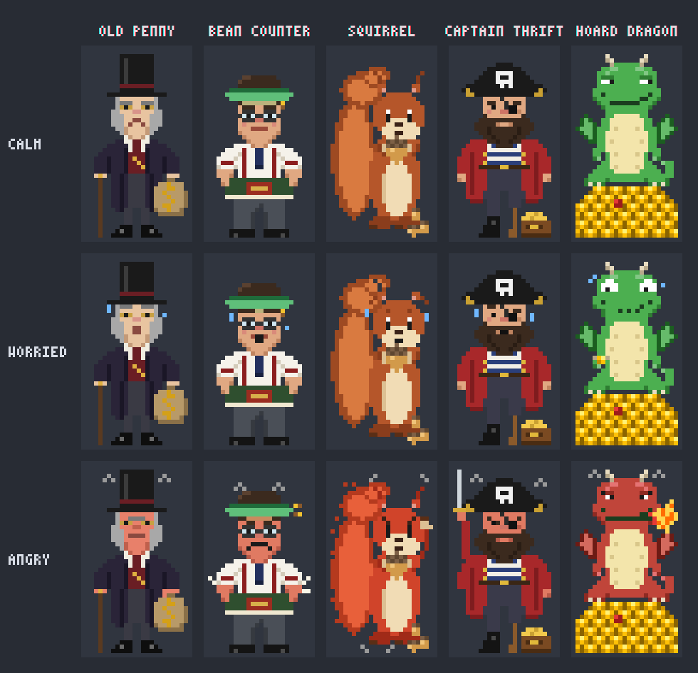

# 🪙 Frugalitas

*Frugalitas* is Latin for thrift: tokens are not infinite.

A Claude Code plugin that watches what you spend through a LiteLLM proxy (pay-as-you-go), using the proxy's own
spend bookkeeping. It is active only in sessions that run through LiteLLM (`ANTHROPIC_BASE_URL` +
`ANTHROPIC_AUTH_TOKEN`, optionally `ANTHROPIC_CUSTOM_HEADERS`); anywhere else it stays silent.



> **See also: [FrugalBar](https://github.com/infinitaslearning/FrugalBar)**, a macOS menu-bar app from a colleague at
> Infinitas Learning that shows your daily and weekly LiteLLM spend at a glance (internal to Infinitas Learning).
> The two complement each other: FrugalBar for the overall picture, Frugalitas inside your Claude Code sessions.

## What it does

- **Status line:** `🪙 🙂 session $1.20/$20.00 · today $22.81/$60.00 · month $585/$800`, refreshed after every turn and
  every 5 minutes. Session spend is the session's own turns (subagents included) priced token by token at the proxy's
  `/model/info` prices, so other sessions or tools on the same key don't leak into it. Today and month are LiteLLM's
  billed numbers. If the key spends clearly more than the session during it, the report and `/frugal tips` say the key is
  probably shared.
- **Budget guard:** a toast at 80% and 100% of each budget (plus a native notification at 100%). In `block` mode, new
  prompts are refused over budget until `/frugal allow` lifts it for the day.
- **`/frugal`:** monthly report with daily bars, per-model breakdown ($/MTok), cache hit rate and savings.
  `/frugal 7` for the last 7 days · `/frugal refresh` · `/frugal panel` for the dashboard · `/frugal help`.
- **Fun mode:** a mood emoji (😇 → 🙂 → 😬 → 🥵 → 🔥 → 💀), a pixel-art mascot on the dashboard whose mood follows your
  budget, quips, and what your spend would have bought (coffees, pizzas, concert tickets…).

All days are UTC days, as LiteLLM counts them.

## Modes: Frugalitas and Fukarléc

One engine, two personalities. The mode changes words, characters and currency; budgets, coins, rank and every
calculation stay the same.

| | Frugalitas mode | Fukarléc mode |
|---|---|---|
| Language | English | Hungarian |
| Mascot and skins | Old Penny and friends | Fukar bácsi: paraszt, csikós, kofa, juhász, matyó |
| Message packs | Old Penny, Grandma, Bartender, Buccaneer, The Auditor | Fukar bácsi, Nagymama, Betyár, Kocsmai, NAV-ellenőr |
| "In kind" | gumballs, coffees, pizzas… in USD | Túró Rudi, lángos, Balaton weekend… in HUF (`hufRate`) |

- `/frugal mode fukarlec` or `/frugal mode frugalitas` switches right away and is remembered across sessions; the
  default for a new install is the `mode` option in `/config`.
- `/frugal` and `/fukarlec` are the same command in either mode, and the old Hungarian subcommand names still work.
- The shop shows the current mode's skins and packs. What you bought stays yours, and each mode keeps what it wears.
- Moving over from the Fukarléc plugin: its 0.2.0 release exports your garas to `~/.claude/fukarlec-ledger.json`;
  Frugalitas folds them in once at the next session start (a day both credited counts once) and starts in Fukarléc
  mode. Then `/plugin uninstall fukarlec`.

## Prompt-cache countdown

The prompt cache stays warm for 5 minutes (an hour with `promptCacheTtl: "1h"` or `CLAUDE_CODE_PROMPT_CACHE_TTL=1h`),
counted from the start of the last model request of a turn, not from the turn's end: each request restarts the cache's
lifetime when it starts, so a long final answer eats into it. The countdown starts there too. After that, the next turn
rewrites the whole context at cache-write price.
If the final answer itself took longer than the cache's lifetime, the turn ends with the cache already expired, and the
status line and the keep/compact/clear advice say so right away.

- **Status line:** `… · ⏳ cache 3:42`, in the last minute `⌛ cache 0:42!`, then `❄️ cache expired`. It doesn't count while
  a turn runs, since the cache is being refreshed then.
- **Dashboard model and context:** the session's model with its prices per million tokens, and how full the
  context window is (`Context: 182k / 1M ▰▰▱▱▱▱▱▱▱▱ 18%`, red from 80%) with what every turn pays at least to read it.
- **Dashboard:** under the "Cache: X% hit" line, `⏳ Cache: 3:42 ▰▰▰▰▰▰▰▱▱▱`, red in the last minute.
- **~30 s before expiry** (for contexts over 50k tokens): a toast with the price of the rewrite, and what a `/compact`
  would cost right now while the cache is still warm. If the rewrite is $0.50 or more, a native notification too.
- **At expiry:** the next 10 turns priced three or four ways (keep going, `/compact`, `/frugal restart` when it is
  clearly cheaper, `/clear`) from the proxy's real prices, with
  a recommendation: on the same task keep going, compact or restart; for a new task, `/clear`. While the cache stays expired this
  also shows on the dashboard and in `/frugal tips`.
- It keeps counting after `/reload-plugins`: the countdown's start is kept per session.

## Restart from a handover

Once the cache has expired, continuing a big conversation rewrites all of it on your main model, and a `/compact` does
too. `/frugal restart` does the same job with a small model instead:

1. it reads the conversation, keeping every word said and clipping long tool outputs to their head and tail;
2. the cheapest Haiku (or, if the conversation is too big for it, Sonnet) that the proxy serves writes a handover: goal,
   current state, decisions, dead ends, open questions, next steps and files;
3. it runs `/clear` and continues from the handover in the now small conversation.

`/frugal restart sonnet` uses a Sonnet for a session with tricky reasoning.

Every handover is saved as Markdown in `~/.claude/handovers/<id>.md` (time, model, project folder and the text), so
nothing is lost if the restart stops half-way and you can pick it up again later:

- `/frugal handovers` lists the recent ones, `/frugal handovers <id>` shows one;
- `/frugal resume <id>` continues from one in the current session, for example a new session the next day.

Until teambrain is available these local files are the handovers' home; once it is, they can go there too.

It is only suggested, never done on its own: when the cache has expired, the context is at least 50k tokens and the
restart is clearly cheaper than both keeping the context and `/compact` over the next 10 turns. The
keep / compact / restart / clear comparison and the warning before you send then name it with its price. For a new task,
`/clear` is still the cheapest.

## Session spend

The session figure comes from the session's own turns, not from the key's total spend:

- **What it counts:** every turn's tokens (the main thread and subagents): input, output, cache read and cache write, at
  the proxy's `/model/info` prices. For Opus 5.5 that is, for example, $4 / $20 / $0.20 / $5 per million tokens.
- **1-hour cache** (`promptCacheTtl: "1h"`): cache writes cost more, 2× input instead of the 5-minute cache's 1.25×, and
  are priced that way.
- **When it updates:** right at the end of every turn, without waiting for LiteLLM's batched spend writes.
- **It persists:** it's kept per session, so `/reload-plugins` doesn't reset it.
- **Before prices arrive:** a turn's cost waits in a queue and is counted as soon as the prices load.
- **Expensive turn:** when a turn (with the subagents that ran during it) reaches the `expensiveTurn` threshold, you hear
  about it right at the turn's end.
- **Parallel use:** the change in the key's spend during the session is kept as a check. When it is at least $1 and more
  than 1.3× the session's own spend + $0.50, the report and `/frugal tips` say the key is probably shared with another
  session or tool.
- **What isn't in it:** small background calls outside turns (such as generating the session title). So the session
  figure can run slightly low; the authoritative, billed amounts are today and month, which come from LiteLLM.

## Savings tips

Tips arrive as toasts (ordinary ones at most every 30 minutes, urgent ones right away, each only once), in the
dashboard's Tip block, and all at once with `/frugal tips`. They speak in the voice of your message pack.

- **During a session:** ⏳ an expired prompt cache (after a 5+ minute break the next turn rewrites the whole context —
  warned before you send, with an estimated price), 🐘 a fat context, 📦 huge Bash/Read outputs, 🔁 the same file read
  over and over, 🤖 subagent-heavy sessions, ✂️ how much a `/compact` saved.
- **From LiteLLM's numbers:** 📈 month-end forecast against the monthly budget, ✍️ output-token cost share,
  ⚠️ failed requests, 📅 your dearest weekday, 🧠 Opus-heavy days, 🧊 a low cache hit rate. Prices come from the proxy's
  `/model/info`.
- **🎯 Daily quest:** e.g. "keep Opus under 50% of the spend"; met on a closed day within budget, it pays +5 coins.

## Coins, ranks and the shop

Every closed (UTC) day on which you worked but stayed within the daily budget earns **coins**:
10 base + up to 10 for the share you didn't spend + a streak bonus (+2 a day, up to +10). Idle days earn nothing but
don't break the streak; a day over budget earns 0 and breaks it. A credited day is frozen, so raising the budget later
pays nothing retroactively.

Ranks: 🪙 Apprentice Saver → 🐷 Penny Pincher (50) → 🧮 Bean Counter (150) → 💼 Treasurer (350) → 🎩 Tycoon (700) →
🏰 Grand Miser (1200).

Spend the coins in Old Penny's shop:

| Skin | Price | | Message pack | Price |
|---|---|---|---|---|
| Old Penny (`miser`) | free | | Old Penny (`miser`) | free |
| Bean Counter (`accountant`) | 150 | | Grandma (`grandma`) | 60 |
| Stash Squirrel (`squirrel`) | 150 | | Bartender (`bartender`) | 60 |
| Captain Thrift (`pirate`) | 200 | | Buccaneer (`buccaneer`) | 90 |
| Hoard Dragon (`dragon`) | 300 | | The Auditor (`auditor`) | 120 |

`/frugal xp` · `/frugal shop` · `/frugal buy <id>` (buys, then wears it) ·
`/frugal skin <id>` / `/frugal pack <id>` (wear something you own; never buys)

Coins are kept per machine, in the plugin's local store.

## Install

```
/plugin install frugalitas --marketplace siposzoltan03/frugalitas
```

Answer `y` to add the marketplace, then pick a scope. Updates: `/plugin update frugalitas`, then `/reload-plugins`.

For local development from a clone:

```
/plugin marketplace add ~/projects/frugalitas
/plugin install frugalitas@frugalitas
```

With a local folder as the marketplace, `/reload-plugins` picks up edits.

## opencode

An experimental port runs in [opencode](https://opencode.ai) (tested on 1.18.x) and shares the Claude Code plugin's
LiteLLM, pricing, advice and message modules. It reads the connection from an opencode provider named `litellm`
(`baseURL`, `apiKey`, `headers`).

What works: the status line next to the prompt (session, today, month, mood, cache countdown), the 80% and 100% budget
toasts, the expensive-turn toast, the cache warnings and keep/compact/clear advice, the `block` mode, the full report and tips (`/frugal` opens a menu), and coins, ranks and the message-pack shop
(its own ledger in `~/.config/opencode/frugalitas-ledger.json`, separate from Claude Code's). `/frugal restart` as menu entries (a
small model writes a handover, a new session opens with it pre-filled; files in
`~/.config/opencode/frugalitas-handovers/`). Not yet: the dashboard, mascot and skins.

Two entry points, because opencode keeps TUI and server plugins apart. Both read one options file,
`~/.config/opencode/frugalitas.json` (options given on a plugin entry override it):

```json
{ "overBudget": "warn", "sessionBudget": 10, "dailyBudget": 25, "monthlyBudget": 500 }
```

`~/.config/opencode/tui.json`:

```json
{ "plugin": ["/path/to/frugalitas/opencode/tui.tsx"] }
```

`~/.config/opencode/opencode.jsonc` (the budget guard; put it in the global config, not a workspace one that gets regenerated):

```jsonc
"plugin": ["/path/to/frugalitas/opencode/server.ts"]
```

The guard re-reads the file on every prompt; the TUI plugin reads it at startup.

Options: `sessionBudget`, `dailyBudget`, `monthlyBudget`, `overBudget` (`warn`/`block`), `expensiveTurn`, `fun`, `mode`,
`hufRate`, `promptCacheTtl`. With `overBudget: "block"` a prompt over budget is refused; opencode only shows "Failed to
send prompt", so the reason comes as a toast. `/frugal-allow` (palette) lifts the block for the UTC day.

## Settings

`/config` → frugalitas: session, daily and monthly budgets (USD, 0 = none), `warn`/`block` mode, the expensive-turn
threshold, and fun mode.

## Development

```
claude plugin validate .
claude plugin test .
claude -p "/frugal" --plugin-dir .   # with the LiteLLM environment variables set
```
